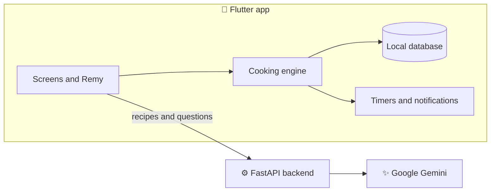

<div align="center">


# Anyone Can Cook

**לבשל כל אחד יכול** · Step-by-step cooking for complete beginners, with a friendly AI assistant

<p>
  
  
  
  
  
</p>

</div>

---

## About

Most recipes assume you already know how to cook. **Anyone Can Cook** turns any recipe into a calm,
guided session: one clear step at a time, timers that start when you do, reminders for what to prepare
ahead, and **Remy**, an assistant you can talk to while your hands are busy.

Bring your own recipe as text, a photo or a link, choose one of the built-in recipes, or ask Remy to
suggest something. The app is Hebrew-first and fully right-to-left.

## Features

| | |
|---|---|
| 📥 **Any recipe, made cookable** | Paste text, snap a photo or share a link. AI turns it into a clear plan you review before cooking. |
| 📚 **Built-in recipes** | 24 ready recipes, from shakshuka to chocolate cake, with search and categories. Works offline. |
| ✨ **Recipe ideas from Remy** | Describe what you feel like or what's in your fridge, and review the recipe before saving it. |
| 🧺 **Preparation checklist** | Tick off ingredients and equipment, and get substitutions for anything missing. |
| 🔥 **Guided cooking** | One action per step, with parallel tasks suggested while you wait. Progress survives closing the app. |
| ⏱️ **Reliable timers** | Several timers at once, with notifications even when the app is closed. |

## Meet Remy


**Remy (רמי)** is the app's cooking assistant. He knows the recipe and exactly where you are in it.

- 🎙️ **Talk while you cook.** In the kitchen Remy opens listening, and "היי רמי" works hands-free.
- ⚡ **Instant basics.** "הבא" (next), "חזרה" (back) and "כמה זמן נשאר?" (time left) are handled on the phone, even offline.
- 💬 **Real answers.** Ask about techniques, substitutions or what to do next.
- 🛡️ **You stay in control.** Remy suggests; important actions happen only after you confirm.
- 🧠 **Remembers the recipe.** Each recipe keeps its own short conversation.

<br clear="right" />

## Screenshots

<div align="center">
<table>
  <tr>
    <td align="center"><br /><sub><b>Home</b></sub></td>
    <td align="center"><br /><sub><b>Recipe catalog</b></sub></td>
    <td align="center"><br /><sub><b>Cooking mode</b></sub></td>
    <td align="center"><br /><sub><b>Remy, voice assistant</b></sub></td>
  </tr>
</table>
</div>

## Tech Stack

| | |
|---|---|
| **App** |    Riverpod · go_router · drift |
| **Backend** |   Pydantic |
| **AI** |  structured output |
| **Hosting** |  |

## Architecture

**AI plans, the app executes.** Gemini turns recipes into structured plans and answers questions. Cooking
itself runs on a deterministic engine on the phone, so steps and timers work offline and recipes stay on
the device.



## Getting Started

Requires Flutter 3.47+, Python 3.12 and an Android emulator or device.

```bash
# Backend
cd backend
py -m venv .venv
.venv/Scripts/python -m pip install -r requirements.txt
.venv/Scripts/python -m uvicorn app.main:app --host 127.0.0.1 --port 8000

# App (in a second terminal)
cd app
flutter pub get
flutter run --dart-define=API_BASE_URL=http://10.0.2.2:8000
```

`10.0.2.2` is how the Android emulator reaches your computer. Server settings, including the AI key, are
read from environment variables (see `backend/.env.example`) and are never stored in the repository.
