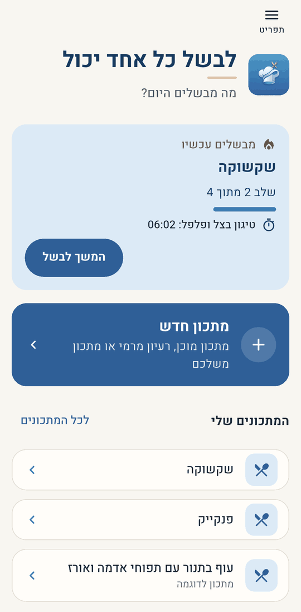
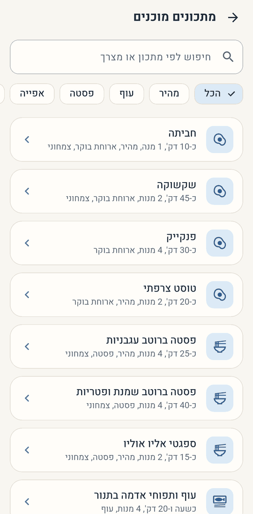
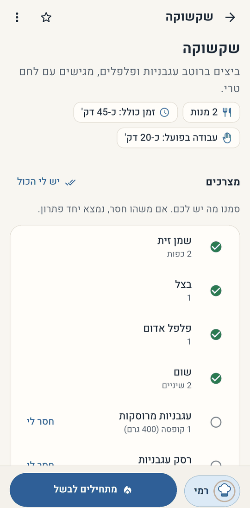
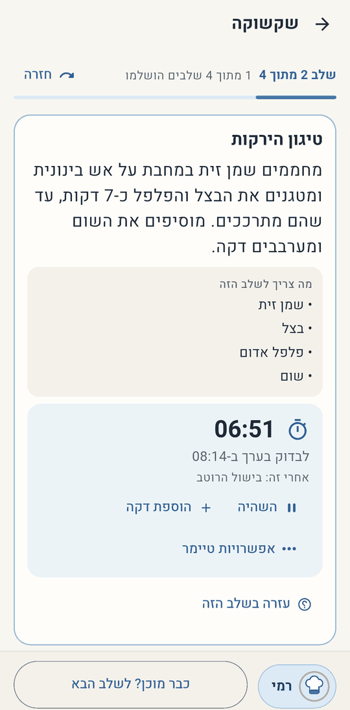
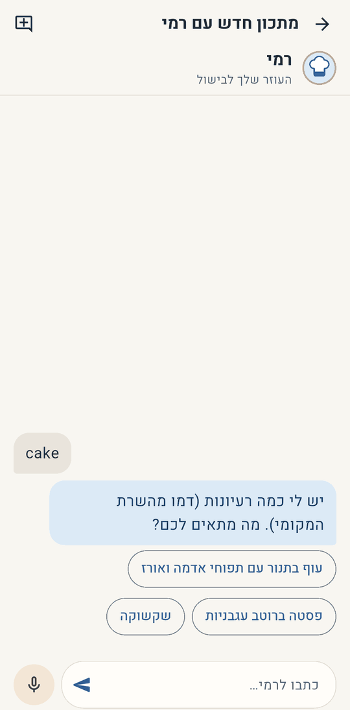
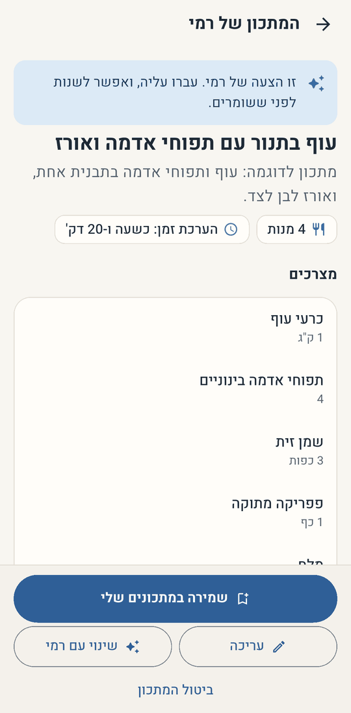
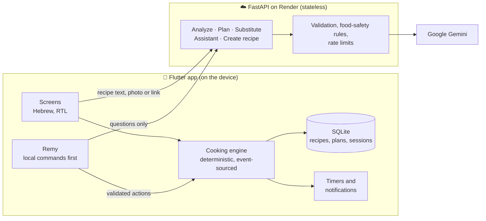

<div align="center">


# Anyone Can Cook

**לבשל כל אחד יכול** · A calm, step-by-step cooking companion for complete beginners

<p>
  
  
  
  
  
  
</p>

<a href="#features">Features</a> ·
<a href="#meet-remy">Remy</a> ·
<a href="#screenshots">Screenshots</a> ·
<a href="#architecture">Architecture</a> ·
<a href="#getting-started">Getting started</a> ·
<a href="#project-status">Status</a> ·
<a href="#roadmap">Roadmap</a>

</div>

---

## What is Anyone Can Cook?

Most recipes are written for people who already know how to cook. **Anyone Can Cook** turns a recipe
into a guided session that a beginner can actually follow: one clear step at a time, timers that start
when you start, reminders for what to prepare ahead, and a friendly assistant, **Remy**, for the questions
that come up along the way.

You can start from a recipe you already have (pasted text, a photo or a link), pick one of the app's
built-in recipes, or ask Remy to suggest one. Before cooking, you review the recipe and tick off what you
have; missing an ingredient? The app suggests a substitute and updates the steps to match.

The app is **Hebrew-only and fully right-to-left**. AI is used to *plan* the cooking; the cooking itself
runs on a deterministic engine on the phone, so steps, timers and progress keep working offline and
survive restarts.

> [!NOTE]
> Anyone Can Cook is in a **private beta** for family and friends on Android. It is not published on
> Google Play or the App Store.

## Features

<table>
  <tr>
    <td width="50%" valign="top">
      <h4>📥 Start from any recipe</h4>
      Paste text, take a photo or share a link. The AI reads the recipe, asks only the questions that
      really matter (for example a missing oven temperature) and builds a step-by-step cooking plan you
      review before saving.
    </td>
    <td width="50%" valign="top">
      <h4>📚 Built-in recipe catalog</h4>
      24 ready recipes (breakfast, pasta, chicken, baking, vegetarian, desserts and quick meals) with
      search and categories. They work fully offline, and you can save your own editable copy.
    </td>
  </tr>
  <tr>
    <td valign="top">
      <h4>✨ Recipes created with Remy</h4>
      Describe what you feel like or what is in your fridge. Remy offers a few options or writes a full
      recipe draft. You review and edit it; nothing is saved until you approve it.
    </td>
    <td valign="top">
      <h4>🧺 Preparation checklist</h4>
      Tick off ingredients and equipment. For missing items you get concrete substitutions, and the
      quantities and steps are updated consistently, with an undo.
    </td>
  </tr>
  <tr>
    <td valign="top">
      <h4>🔥 Guided cooking mode</h4>
      One main action per step, parallel work suggested while you wait, reminders to preheat the oven or
      boil water at the right moment, and progress that survives closing the app.
    </td>
    <td valign="top">
      <h4>⏱️ Reliable timers</h4>
      Several timers at once, started only by your tap and timed from the approved plan. Notifications
      fire with the app closed and are restored after a restart or reboot.
    </td>
  </tr>
  <tr>
    <td valign="top">
      <h4>🗂️ Your kitchen</h4>
      Saved recipes, favourites, unfinished drafts and a cooking history, all stored on the device.
    </td>
    <td valign="top">
      <h4>🛡️ Careful with AI</h4>
      AI estimates are labelled as estimates, food-safety checks flag doneness cues for meat, poultry and
      fish, and the AI never changes your cooking session directly.
    </td>
  </tr>
</table>

## Meet Remy


**Remy (רמי)** is the app's cooking assistant. He knows the recipe you are cooking and where you are in it.

- **Text before cooking, voice while cooking.** Before you start, Remy opens as a chat. In the kitchen,
  he opens listening, so your hands can stay busy. "היי רמי" works hands-free on the cooking screen
  (opt-in, only while the app is open).
- **Fast and local first.** Simple requests such as "הבא" (next), "חזרה" (back) or "כמה זמן נשאר?"
  (how much time is left?) are understood on the phone, instantly and offline. Only real questions go to the AI, with at most one
  call per request.
- **Safe by design.** Remy only *proposes* actions. The app checks each one against the live cooking
  state and asks you to confirm anything important before it happens.
- **Remembers the recipe, not everything.** Each recipe has its own short conversation (up to 20
  messages, forgotten after 12 hours of inactivity) that is cleared when you finish cooking. Nothing is
  mixed between recipes.
- **Helps you decide what to cook.** In recipe-creation mode, Remy suggests dishes and writes a recipe
  draft for you to review.

Speech uses the phone's own Hebrew speech recognition and text-to-speech; if voice is unavailable, Remy
switches to typing.

<br clear="right" />

## Screenshots

<table>
  <tr>
    <td align="center" width="25%"><br /><sub><b>Home</b><br />Cooking in progress and saved recipes</sub></td>
    <td align="center" width="25%"><br /><sub><b>What to cook?</b><br />Catalog, Remy or your own recipe</sub></td>
    <td align="center" width="25%"><br /><sub><b>Recipe catalog</b><br />Search and categories</sub></td>
    <td align="center" width="25%"><br /><sub><b>Preparation</b><br />Checklist before cooking</sub></td>
  </tr>
  <tr>
    <td align="center"><br /><sub><b>Cooking mode</b><br />One step at a time, with a timer</sub></td>
    <td align="center"><br /><sub><b>Remy</b><br />Voice first while cooking</sub></td>
    <td align="center"><br /><sub><b>Create with Remy</b><br />Dish options from a short request*</sub></td>
    <td align="center"><br /><sub><b>Review before saving</b><br />Edit, change with Remy or discard*</sub></td>
  </tr>
</table>

<sub>Real screenshots of the current app on an Android emulator (Pixel 8a, Android 15) with sample data
only. \* These two were recorded against the local development backend, which uses a mock AI provider
instead of Gemini; its replies say "דמו מהשרת המקומי" (local server demo).</sub>

## Tech stack

| Layer | Technologies |
|---|---|
| **Mobile app** |   Riverpod · go_router · freezed |
| **On-device data** |  drift (event-sourced cooking sessions) |
| **Device features** | flutter_local_notifications (exact alarms) · speech_to_text · flutter_tts · image_picker |
| **Backend** |   Pydantic · httpx · trafilatura |
| **AI** |  structured output behind a provider interface (mock provider for development and tests) |
| **Hosting** |  stateless API, no database on the server |
| **Quality** | 327 Flutter tests (unit, widget, contract) · 224 backend tests · shared JSON Schema contract |

## Architecture

The guiding rule: **AI plans, the app executes.** Gemini helps turn a recipe into a structured plan and
answers questions. Everything that happens while cooking is decided by a deterministic engine on the phone.



- **Cooking runs offline.** Every action becomes an event in an append-only log; the session's state is
  rebuilt by replaying it, so progress and timers survive restarts. Duplicate taps are no-ops.
- **Timer durations come only from the approved plan.** Neither the UI nor the AI can invent one.
- **The server keeps no user data.** Each request carries what it needs; recipes stay on the phone.
- **One contract for both sides.** Pydantic models are the source of truth, exported as JSON Schema and
  mirrored by Dart models, with contract tests on both sides.
- **The API key never leaves the server.** The app sends a lightweight app token; the server enforces
  per-device rate limits and a daily AI quota.

<details>
<summary><b>How a recipe becomes a cooking session</b></summary>

1. **Import:** text, a photo or a link is sent to `/v1/recipes/analyze`. Links are fetched safely on
   the server (public addresses only, size and time limits).
2. **Clarify:** only questions that change the result are asked; others are filled in and labelled
   as estimates.
3. **Plan:** `/v1/recipes/plan` returns steps, actions, timers and prep tasks, validated on the server
   and again on the device (dependencies, timers, food-safety cues).
4. **Review and prepare:** the recipe overview shows what you need. Substitutions are stored as patch
   operations, so the effective recipe is always "original + accepted changes".
5. **Cook:** the engine drives the steps; Remy can help, but every change goes through the same
   validated dispatcher as a button tap.

</details>

## Project structure

```text
Anyone-Can-Cook-App/
├── app/                      Flutter app (Android; iOS project included)
│   ├── lib/
│   │   ├── core/             theme, routing, API client, shared widgets
│   │   ├── data/             SQLite (drift) repositories
│   │   ├── models/           freezed models mirroring the JSON contract
│   │   ├── features/
│   │   │   ├── cooking/      cooking engine, dispatcher, cooking screen
│   │   │   ├── assistant/    Remy: commands, service, chat sheet, voice
│   │   │   ├── catalog/      built-in recipes
│   │   │   ├── create/       "what to cook?" hub, Remy recipe creation
│   │   │   ├── prepare/      recipe overview, checklist, substitutions
│   │   │   ├── import/       import, clarifying questions, advanced editing
│   │   │   ├── timers/       notifications and restore
│   │   │   └── …             home, recipes, history, settings
│   │   └── l10n/app_he.arb   all user-facing text (Hebrew)
│   ├── assets/               fonts, branding, sample recipe, recipe catalog
│   └── test/                 unit, widget and contract tests
├── backend/                  FastAPI service (stateless)
│   ├── app/routers/          HTTP endpoints
│   ├── app/services/         analysis, planning, substitution, assistant,
│   │                         recipe creation, URL fetching, LLM providers
│   ├── app/schemas/          Pydantic models: source of truth for the contract
│   ├── app/prompts/          prompts for each AI task
│   └── tests/                backend tests (fake AI provider only)
├── shared/                   exported JSON Schemas and shared fixtures
└── docs/                     plan, progress, decisions, design, release notes, images
```

## Getting started

> [!IMPORTANT]
> You do **not** need an AI key for local development: the backend uses a built-in mock provider by
> default, and all automated tests use fakes.

**Prerequisites:** Flutter 3.47+ (Dart 3.13), Python 3.12, Android Studio with an Android emulator.

### 1. Backend (local, mock AI)

```bash
cd backend
py -m venv .venv
.venv/Scripts/python -m pip install -r requirements-dev.txt
.venv/Scripts/python -m uvicorn app.main:app --host 127.0.0.1 --port 8000
```

Check `http://127.0.0.1:8000/health`; it should report `"ai_provider": "mock"`. The commands above use the
Windows virtual-environment layout; on macOS or Linux use `.venv/bin/python`.

### 2. Flutter app

```bash
cd app
flutter pub get
flutter run -d emulator-5554 --dart-define=API_BASE_URL=http://10.0.2.2:8000
```

`10.0.2.2` is how the Android emulator reaches your computer's `127.0.0.1`. Plain HTTP is allowed only in
debug builds and only to local addresses. Cooking, timers and the built-in recipes work even without the
backend.

### 3. Tests and checks

```bash
# backend
cd backend && .venv/Scripts/python -m pytest -q

# app
cd app
flutter analyze
flutter test --timeout 90s
```

<details>
<summary><b>After changing models, database tables or strings</b></summary>

```bash
# Pydantic schemas changed (backend/app/schemas): re-export the shared JSON Schema
cd backend && .venv/Scripts/python -m scripts.export_schemas

# drift tables or freezed models changed
cd app && dart run build_runner build

# Hebrew strings changed (app/lib/l10n/app_he.arb)
cd app && flutter gen-l10n
```

A backend test fails if the exported schemas are stale, and `app/test/contract_test.dart` checks that the
Dart models match them. `app/assets/recipes/sample_recipe.json` must stay identical to
`shared/fixtures/sample_recipe.json` (also tested).

</details>

<details>
<summary><b>Running against a deployed backend</b></summary>

Keep build-time values in a JSON file **outside the repository**, for example:

```json
{
  "API_BASE_URL": "https://<your-service>.onrender.com",
  "APP_CLIENT_TOKEN": "<the value set as APP_CLIENT_TOKEN on the server>"
}
```

```bash
flutter run -d emulator-5554 --dart-define-from-file=<path-outside-the-repo>/dart_defines.json
```

The app token is an abuse deterrent, not authentication: it ships inside the app. The AI key exists only
in the server's environment.

</details>

<details>
<summary><b>Deploying the backend (Render)</b></summary>

- Root directory: `backend`
- Build command: `pip install -r requirements.txt`
- Start command: `uvicorn app.main:app --host 0.0.0.0 --port $PORT`
- Environment variables (set in Render, never in the repository): `AI_PROVIDER=gemini`, `GEMINI_API_KEY`,
  `APP_CLIENT_TOKEN`, `AI_MODEL`, and optionally `PARSE_MODEL`, `PLAN_MODEL`, `CHAT_MODEL`. See
  `backend/.env.example` for all settings.

On the free plan the service sleeps when idle; the first request can take up to about a minute, and the
app shows a friendly waiting message.

</details>

<details>
<summary><b>Android beta builds</b></summary>

Release builds are signed with a private key kept outside the repository; the build falls back to the
debug key when it is missing. The full process, including how testers install updates without losing
their recipes, is in [`docs/RELEASE.md`](docs/RELEASE.md).

</details>

## Project status

| Area | Status |
|---|---|
| Deterministic cooking engine, timers, notifications, offline storage | ✅ Implemented and tested |
| AI recipe import (text, photo, link), clarifying questions, plan review | ✅ Implemented; live-tested with real recipes |
| Preparation checklist and substitutions | ✅ Implemented |
| Remy: chat, local commands, voice, hands-free "היי רמי", per-recipe memory | ✅ Implemented; voice depends on the phone's Hebrew speech services |
| Built-in catalog (24 recipes) | ✅ Implemented; works offline |
| Recipe creation with Remy | 🧪 Implemented and tested with a mock AI; not yet tried with the live AI |
| Visual redesign and accessibility checks | ✅ Implemented |
| Android private beta | 🧪 In progress with a small group of testers |
| iOS | ⏳ Project and icons prepared; not built or tested yet (needs macOS) |
| Public store release | ⏳ Not started |

Known limitations: quantities are not scaled when you change the number of servings; the app token can be
extracted from the APK, so the server's rate limits and daily quota are the real protection; rate limits
live in the server's memory and reset when it restarts; catalog recipes have no photos.

## Roadmap

- **Feedback from the beta:** fix rough edges reported by testers, especially around voice and recipe import.
- **Servings scaling:** adjust quantities when cooking for more or fewer people.
- **Recipe discovery:** search the web for a dish and import a chosen result with its original source.
- **Backup and restore:** export and import recipes as a file, before any accounts exist.
- **Stronger abuse protection:** device attestation (App Check) or optional accounts instead of the shared app token.
- **iOS build and a public release:** store listings, a privacy policy and a paid AI tier for user privacy.

## Documentation

| Document | What's inside |
|---|---|
| [`docs/PLAN.md`](docs/PLAN.md) | The approved product and technical plan, phase by phase |
| [`docs/DESIGN.md`](docs/DESIGN.md) | UX/UI design system, navigation and screen design |
| [`docs/DECISIONS.md`](docs/DECISIONS.md) | Decision log with the reasoning behind each choice |
| [`docs/PROGRESS.md`](docs/PROGRESS.md) | Detailed progress, verification results and next steps |
| [`docs/RELEASE.md`](docs/RELEASE.md) | Building and sharing the private Android beta |

## Security and privacy

- No secrets in the repository: `.env` files, signing keys and build-time tokens stay outside it.
- The Gemini API key exists only in the server's environment.
- Recipes, cooking history and conversations with Remy are stored on the device; the server stores nothing.
- The free Gemini tier may use requests to improve Google's products; the app tells users this before
  their first import and asks them not to send personal information.


